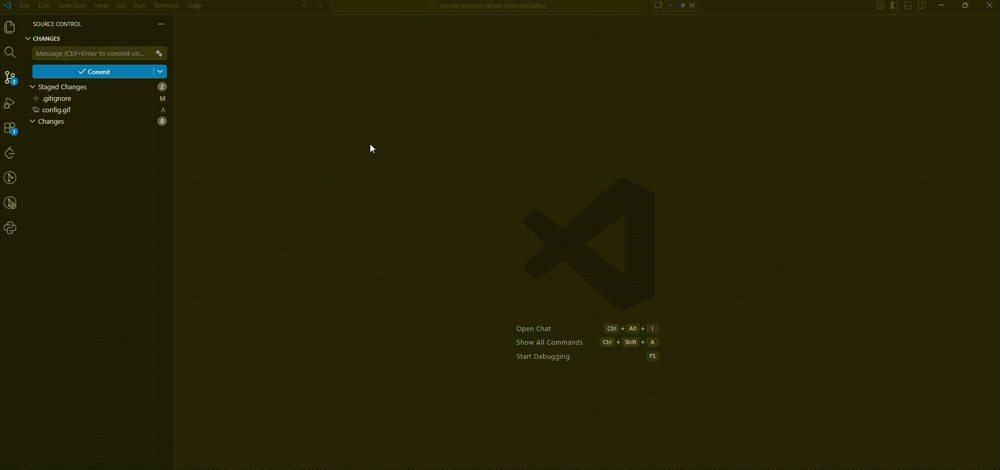
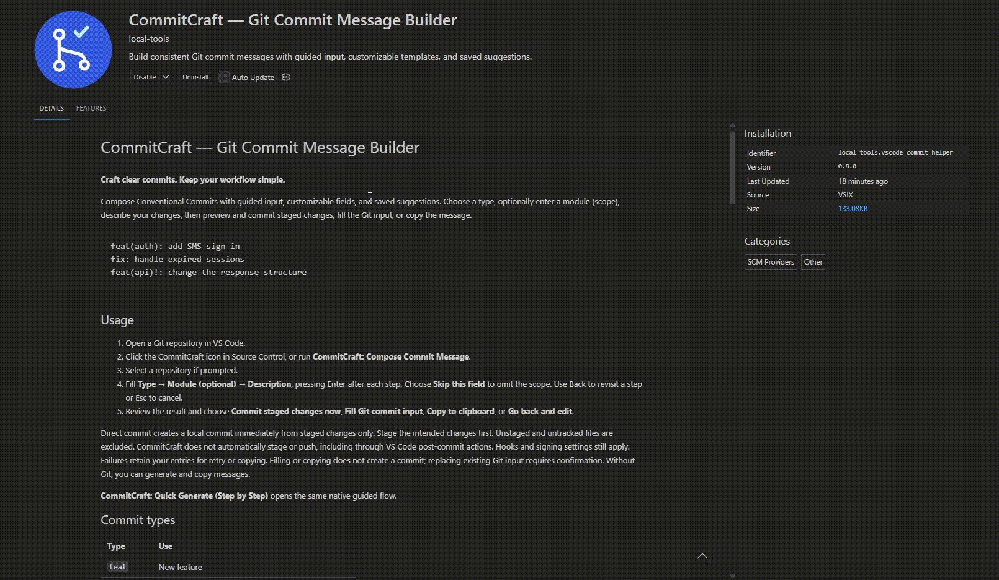

# CommitCraft — Git Commit Message Builder

**Craft clear commits. Keep your workflow simple.**

Build consistent Git commit messages without leaving VS Code. Choose a type, describe your change, review the message, and commit staged changes, fill the Git input, or copy it anywhere.

```text
feat(auth): add SMS sign-in
fix: handle expired sessions
```

- **Press Enter to continue.** Native step-by-step input, with Back and Esc support.
- **Choose your convention.** Conventional Commits by default, plus a versioned preset with Chinese types.
- **Shape your fields.** Add, remove, reorder, disable, or mark fields optional in a visual editor.
- **Reuse previous values.** Suggestions and recent selections are remembered per repository.
- **Review, then act.** Commit staged changes directly, fill the Git input, or copy the message.

## Quick start

1. Open a Git repository in VS Code.
2. Click the **CommitCraft** icon in the Source Control title bar, or open the Command Palette and run **CommitCraft: Compose Commit Message**.
3. Choose or enter **Type → Module (optional) → Description**, pressing **Enter** after each step. Select **Skip this field** to omit the scope. If multiple repositories are open, select the target first.
4. Review the result and choose your final action.



*Recorded in VS Code: choose `feat`, enter module `login` and description `test`, review `feat(login): test`, then choose **Fill Git commit input**. The recording fills the input; it does not create a commit. Back revisits a step; Esc cancels without changing the Git input.*

| Final action | Result |
| --- | --- |
| **Commit staged changes now** | Immediately creates a local commit from staged changes, using the generated message. |
| **Fill Git commit input** | Puts the message into the selected repository's Git input for your usual commit workflow. |
| **Copy to clipboard** | Copies the message without changing the Git input or creating a commit. |
| **Go back and edit** | Returns to the first step and keeps your entries. |

For direct commit, **stage the intended files first**. CommitCraft does not automatically stage or push; unstaged edits and untracked files stay out. Git hooks and signing settings still apply. A failed commit keeps your entries available for retry, editing, or copying. Existing Git input requires confirmation before replacement.

## Two built-in rules

| | Rule 1 · Conventional Commits | Rule 2 · Versioned commits |
| --- | --- | --- |
| Best for | Conventional commit headers | Teams that include a product version in every message |
| Steps | Type → Module (optional) → Description | Type → Version → Module → Description |
| Type choices | English, such as `feat`, `fix`, `docs` | Chinese equivalents of the same 11 types |
| Required fields | Type and description | All four fields |
| Output | `fix(auth): handle expired sessions` | `【修复】【4.5.0】【auth】Handle expired sessions` |

**Rule 1 is the default.** Rule 2 includes versions `1.0.0`, `1.5.0`, `2.0.0`, `2.5.0`, `3.0.0`, `3.5.0`, `4.0.0`, and `4.5.0`; its initial version is `1.0.0`. Rule 2 follows a custom team format rather than Conventional Commits.

### Switch rules

1. Click the **gear beside CommitCraft** in Source Control, or run **CommitCraft: Configure Commit Fields**. You can also use **Open field editor** under **Field Layout** in VS Code Settings.
   The recording follows another route: open the extension's gear menu, choose **Extension Settings**, then click **Open field editor** under **Field Layout**.
2. Choose **Rule 1** or **Rule 2** above the fields.
3. Review the fields, suggestions, template, and output preview. Adjust them if needed.
4. Choose a save location and click **Save changes**.



*Recorded in VS Code with the English interface. The recording switches between the versioned and conventional presets, checks the output template and preview, then saves. Choosing a rule replaces the current editor contents, including unsaved field edits; active settings change only after saving. Module suggestions from the base settings and usage history are retained.*

## Commit types and format

| Type | Meaning | Rule 2 value |
| --- | --- | --- |
| `feat` | New feature | `新增` |
| `fix` | Bug fix | `修复` |
| `docs` | Documentation | `文档` |
| `style` | Formatting without changing behavior | `格式` |
| `refactor` | Restructuring without adding a feature or fixing a bug | `重构` |
| `perf` | Performance improvement | `优化` |
| `test` | Tests | `测试` |
| `build` | Build system or dependencies | `构建` |
| `ci` | Continuous integration | `集成` |
| `chore` | Maintenance | `维护` |
| `revert` | Reverting changes | `回退` |

Rule 1 produces a [Conventional Commits](https://www.conventionalcommits.org/en/v1.0.0/) header:

```text
type(scope): description
```

The scope is optional: skipping it produces `fix: handle expired sessions`, with no empty parentheses. Custom alphabetic types are accepted. Append `!` to the type for a breaking change: type `feat!` with scope `api` produces `feat(api)!: change the response structure`.

Descriptions can be English or Chinese. These are common type suggestions, not an exhaustive list mandated by the specification. CommitCraft currently generates **single-line headers**; it has no separate body or footer inputs.

## Customize fields

Open **Configure Commit Fields** to manage your project's format. Daily commits continue to use native step-by-step input.

| Control | What you can change |
| --- | --- |
| Field name and order | Rename, move up/down, add, delete, or temporarily disable fields. |
| Input | Use suggestions with custom input, or free text. Set candidates and a default value. |
| Required | Make a field required or allow it to be skipped. Keep at least one enabled, required field. |
| Remember used values | Keep previous values as repository suggestions. |
| Prefix and suffix | Wrap a module in parentheses, a version in brackets, or use your own separators. |
| Output template | Use automatic output or turn it off to edit the template directly. |

Automatic output joins enabled fields in order using their prefixes and suffixes. Skipped optional fields omit their entire segment, including wrappers. In custom templates, use each enabled field's stable ID exactly once, and keep optional prefix/token/suffix segments together. Renaming a field retains its ID and history.

**Saving:** choose **User**, **Workspace**, or **Folder**. Folder settings take precedence over workspace settings, which take precedence over user settings. In a multi-folder workspace, choose the target folder when opening the editor. Closing the page discards unsaved changes. If settings change externally, reload before saving again.

Existing customized fields and explicitly configured older templates are preserved on upgrade. **Restore original fields**, then Save, returns to the base settings; unchanged defaults use Rule 1.

### Optional JSON configuration

The visual editor is sufficient for ordinary use. For base candidates and the standard template, you can also use VS Code Settings:

```json
{
  "commitHelper.types": ["feat", "fix", "docs", "style", "refactor", "perf", "test", "build", "ci", "chore", "revert"],
  "commitHelper.modules": ["auth", "dashboard", "settings"],
  "commitHelper.template": "{type}({module}): {description}",
  "commitHelper.rememberLastValues": true
}
```

After saving custom fields, manage their candidates, defaults, and output in the field editor. They are stored in `commitHelper.fieldLayout`; `null` or `{}` uses the base settings. **Edit in settings.json** opens advanced manual configuration, with a full preset available in JSON completions. `commitHelper.versions` and `commitHelper.defaultVersion` remain available for older four-field templates. Product versions are not read from `package.json`.

## Saved suggestions

After a successful commit, fill, or copy operation, values from fields with **Remember used values** enabled are saved for that repository in the current workspace. Recent values appear first. Rule 1 remembers type and module by default; descriptions are not remembered. A recent selection takes precedence over an initial default, including version values in Rule 2.

- Failed or cancelled operations and declined replacements do not add history.
- Deleting or disabling a field does not erase its history.
- Removing a configured suggestion does not delete previous uses. Turn off that field's memory to ignore its history.
- Rule 1 filters incompatible old type history, such as Chinese type names, without deleting it.
- Set `commitHelper.rememberLastValues` to `false` to stop reading and saving all history.

## Requirements and common questions

Requires **VS Code 1.85+**. Filling the Git input and direct commit use VS Code's built-in Git extension. Without Git, use the Command Palette to generate and copy a message. **CommitCraft: Quick Generate (Step by Step)** opens the same guided flow.

**Can I change the interface language?** The interface follows VS Code's display language: English by default, Chinese for Chinese locales. Types, candidates, descriptions, and history remain as you entered them.

**Why did my new rule not apply?** Click **Save changes**, and check the save location: a folder configuration can override workspace or user settings.

**Why is the version field missing?** Rule 1 has no version step. Open the field editor, choose Rule 2, then save.

**Why can't I commit directly?** Stage your changes first. Resolve merge conflicts or an active rebase, and use a trusted workspace. Commit failures remain visible so you can retry or copy the message.

License: MIT.

---

# CommitCraft — Git 提交信息助手

**让提交清晰，让流程简单。**

在 VS Code 中选择类型、填写修改、预览结果，直接提交已暂存改动、填入 Git 输入框，或复制到其他地方使用。

```text
feat(auth): 新增短信登录
fix: 修复登录过期处理
```

- **回车下一项**：原生分步输入，支持返回修改和 Esc 取消。
- **两套内置规则**：默认约定式提交，也可切换中文类型与产品版本格式。
- **字段自由配置**：可视化增删、排序、启停及必填/选填设置。
- **复用使用记录**：按仓库记住候选和最近选择。
- **预览后再操作**：直接提交已暂存改动、填入 Git 输入框或复制。

## 快速上手

1. 在 VS Code 中打开 Git 仓库。
2. 点击源代码管理面板标题栏的 **CommitCraft 图标**，或在命令面板执行 **CommitCraft: 编写提交信息**。
3. 按 **类型 → 模块（选填）→ 描述** 依次选择或填写，**回车**进入下一项。模块可选择 **跳过此项**。存在多个仓库时，先选择目标仓库。
4. 核对预览结果，选择最终操作。


*上图为 VS Code 真实录屏：选择类型 `feat`，填写模块 `login`、描述 `test`，预览 `feat(login): test`，最后选择 **Fill Git commit input（填入 Git 提交输入框）**。这段录屏仅演示填入，并未创建提交。返回按钮修改上一步，Esc 取消且不改变 Git 输入框。*

| 最终操作 | 作用 |
| --- | --- |
| **直接 Git 提交（仅已暂存改动）** | 使用生成的信息，立即在目标仓库创建本地提交。 |
| **填入 Git 提交输入框** | 填入目标仓库，随后按平时的方式提交。 |
| **复制到剪贴板** | 仅复制，不修改 Git 输入框、不创建提交。 |
| **返回修改** | 保留已填写内容，从第一项重新编辑。 |

直接提交前请先 **暂存需要提交的文件**。插件不自动暂存或推送，不包含未暂存和未跟踪文件；Git hooks 和签名设置正常生效。提交失败保留填写内容，可重试、修改或复制。替换 Git 输入框已有内容时会先确认。

## 两套内置规则

| | 规则1 · 约定式提交 | 规则2 · 版本提交 |
| --- | --- | --- |
| 适用场景 | Conventional Commits 标题 | 需要在提交信息中记录产品版本的团队 |
| 填写顺序 | 类型 → 模块（选填）→ 描述 | 类型 → 版本 → 模块 → 描述 |
| 类型候选 | `feat`、`fix`、`docs` 等英文值 | 新增、修复、文档等中文值 |
| 必填项 | 类型、描述 | 四项均必填 |
| 输出示例 | `fix(auth): 修复登录过期处理` | `【修复】【4.5.0】【用户登录】修复登录过期处理` |

**默认使用规则1。** 规则2预置版本 `1.0.0`、`1.5.0`、`2.0.0`、`2.5.0`、`3.0.0`、`3.5.0`、`4.0.0`、`4.5.0`，初始默认值为 `1.0.0`。规则2采用团队自定义格式。

### 切换规则

1. 点击源代码管理面板 **CommitCraft 旁的齿轮**，或执行 **CommitCraft: 配置提交字段**。也可在扩展设置 **Field Layout** 的说明中点击 **打开字段配置页**。
   录屏使用的是另一条入口：扩展详情页的齿轮菜单 → **Extension Settings（扩展设置）** → **Field Layout** 下的 **Open field editor（打开字段配置页）**。
2. 点击字段上方的 **规则1** 或 **规则2**。
3. 核对字段、候选、模板和输出预览，需要时继续调整。
4. 选择保存位置，点击 **保存修改**。


*上图为英文界面的真实录屏，展示版本提交与约定式提交预设的切换、模板及输出预览，以及保存操作。点击规则会覆盖当前编辑内容，包括未保存的字段修改；保存后才应用到日常提交。基础设置中的模块候选及使用历史继续保留。*

## 类型和输出格式

| 规则1类型 | 含义 | 规则2类型 |
| --- | --- | --- |
| `feat` | 新功能 | 新增 |
| `fix` | 修复问题 | 修复 |
| `docs` | 文档变更 | 文档 |
| `style` | 格式调整，不改变代码行为 | 格式 |
| `refactor` | 重构，不新增功能或修复问题 | 重构 |
| `perf` | 性能优化 | 优化 |
| `test` | 添加或修改测试 | 测试 |
| `build` | 构建系统或依赖变更 | 构建 |
| `ci` | 持续集成配置 | 集成 |
| `chore` | 日常维护 | 维护 |
| `revert` | 回退修改 | 回退 |

规则1生成 [Conventional Commits（约定式提交）](https://www.conventionalcommits.org/zh-hans/v1.0.0/) 标题：

```text
类型(模块): 描述
```

模块选填，跳过后输出 `fix: 修复登录过期处理`，不会留下空括号。允许输入自定义英文类型；破坏兼容性的变更可在类型末尾加 `!`：类型 `feat!`、模块 `api` 会输出 `feat(api)!: 调整接口响应结构`。

描述可使用中文或英文。内置类型是常用候选，并非规范规定的完整清单。目前生成 **单行提交标题**，没有独立正文或页脚输入。

## 自定义字段

打开 **配置提交字段** 管理项目格式，日常提交仍然使用原生分步输入。

| 配置项 | 可调整内容 |
| --- | --- |
| 名称和顺序 | 重命名、上移/下移、添加、删除或暂时停用字段。 |
| 输入方式 | 候选加自定义输入，或自由输入；设置候选和默认值。 |
| 必填 | 设置为必填或允许跳过，至少保留一个启用且必填的字段。 |
| 记住用过的值 | 将以前填写的值作为当前仓库的候选。 |
| 前缀和后缀 | 模块加括号、版本加方括号，或使用自定义分隔符。 |
| 输出模板 | 自动按字段拼接，或关闭自动模式后手动编辑。 |

自动模式按字段顺序及前后缀拼接。选填为空时省略完整片段，包括括号。自定义模板中每个启用字段的固定标识使用一次；选填字段的前缀、占位符、后缀应保持连续，才能在空值时一起省略。修改名称保留固定标识和历史。

**保存位置：** 支持用户、工作区、文件夹，文件夹优先于工作区，工作区优先于用户设置。多文件夹工作区打开配置页时选择目标目录。关闭页面会丢弃未保存内容，外部配置变化后需先重新载入。

升级保留已有自定义布局和明确配置的旧模板。点击 **恢复原有字段** 并保存，回到基础设置；未改动默认设置时使用规则1。

### 可选的 JSON 配置

日常使用可直接通过可视化配置页管理。基础候选和标准模板也可以在 VS Code 设置中配置：

```json
{
  "commitHelper.types": ["feat", "fix", "docs", "style", "refactor", "perf", "test", "build", "ci", "chore", "revert"],
  "commitHelper.modules": ["auth", "dashboard", "settings"],
  "commitHelper.template": "{type}({module}): {description}",
  "commitHelper.rememberLastValues": true
}
```

保存自定义字段后，请在配置页维护对应候选、默认值和格式。自定义布局保存在 `commitHelper.fieldLayout`，`null` 或 `{}` 沿用基础设置。**在 settings.json 中编辑** 是高级手动入口，JSON 补全提供完整预设。`commitHelper.versions` 和 `commitHelper.defaultVersion` 继续用于兼容旧四项模板，不自动读取 `package.json` 版本。

## 使用记录

成功提交、填入或复制后，在当前工作区按仓库保留勾选 **记住用过的值** 的字段，最近使用优先。规则1默认记忆类型和模块，不记忆描述。最近选择优先于初始默认值，规则2的版本也遵循此规则。

- 失败、取消或拒绝覆盖不新增记录。
- 删除或停用字段不会删除它的历史。
- 删除配置候选不清除以前使用的值；关闭该字段的记忆即可忽略历史。
- 规则1会过滤旧中文类型等不兼容候选，但不会删除历史。
- 关闭 `commitHelper.rememberLastValues` 可停止全部历史读写。

## 环境要求与常见问题

需要 **VS Code 1.85+**。填入和直接提交依赖 VS Code 内置 Git 扩展；Git 不可用时，可通过命令面板生成并复制。**CommitCraft: 快速生成（分步输入）** 使用同一套流程。

**界面如何切换语言？** 跟随 VS Code 显示语言，默认英文，中文环境显示中文；类型、候选、描述和历史不会自动翻译。

**为什么切换规则没有生效？** 点击 **保存修改**，并检查保存位置；文件夹设置可能覆盖工作区或用户设置。

**为什么没有版本填写项？** 规则1没有版本项。打开配置页，选择规则2并保存。

**为什么无法直接提交？** 先暂存文件，处理冲突或进行中的变基，并确保工作区受信任。提交失败会显示原因，可保留内容重试或复制。

许可证：MIT。

